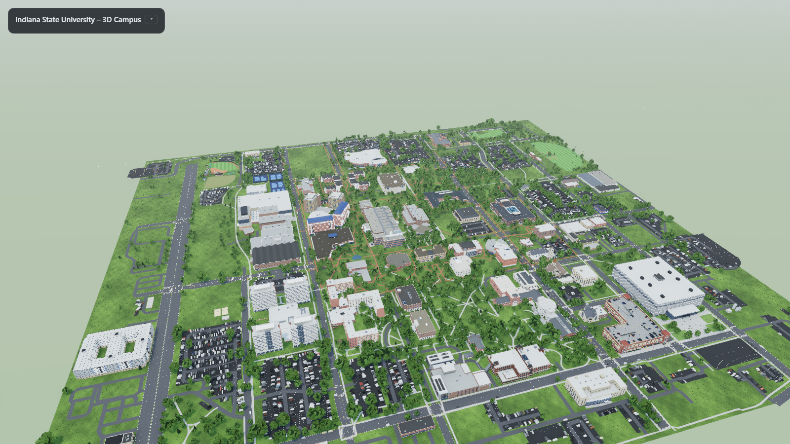
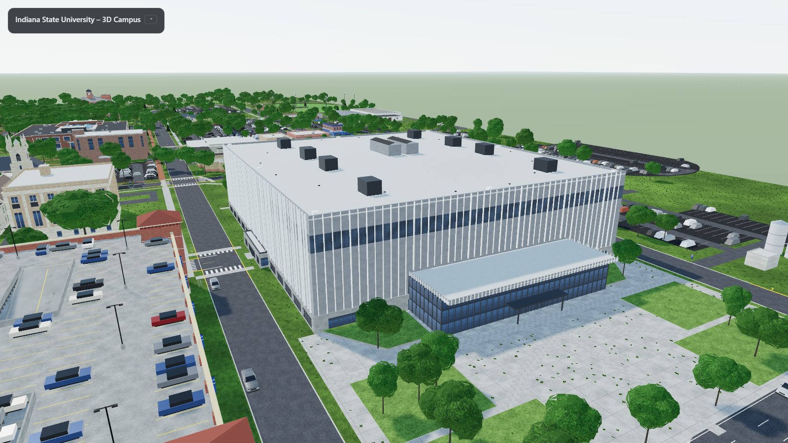
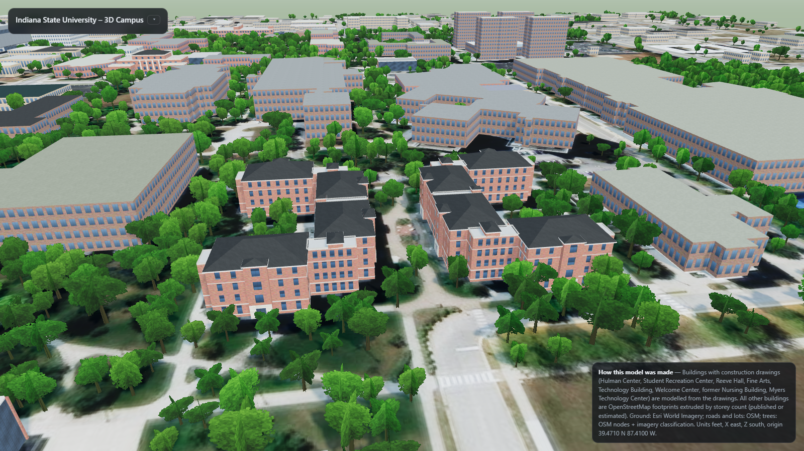
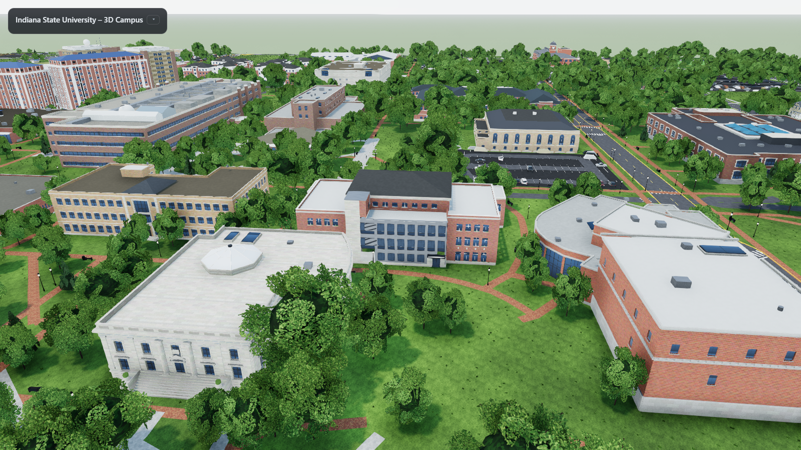

# Indiana State University – 3D Campus Model

A browser-viewable 3D model of the **Indiana State University main campus** (Terre Haute, Indiana).
The model covers the campus between 3rd and 9th Streets and between Tippecanoe and Cherry Streets. Eight buildings
for which construction drawings were available are modelled from those drawings. Every other building is modelled
in 3D from Google Street View photos and Esri satellite imagery: storey counts, wall materials, window rhythm,
entrances, roof forms and rooftop plant. The ground is built as real surfaces rather than a draped photo: asphalt
streets with curbs and lane markings, brick-paver and concrete walks, striped parking lots with cars, lawns with
grass tufts, lamp posts, and 3D trees placed on the tree crowns detected in summer imagery.



| Hulman Center | Reeve Hall | Fine Arts Building |
|---|---|---|
|  |  |  |

**Live viewer:** https://youngbrain85.github.io/isu-campus-3d/viewer/ (GitHub Pages from the `main` branch; the root
`index.html` redirects to the viewer).

## What is in the repository

| Path | Contents |
|---|---|
| `viewer/` | Three.js r170 viewer (ES modules from jsDelivr). `index.html` = CDN build, `index_local.html` = uses `node_modules/three`. |
| `viewer/app.js`, `viewer/lib/*.js` | Scene assembly, geometry/material helpers, ground surfaces (streets, walks, lots, lamps, cars), trees, labels. |
| `viewer/buildings/*.js` | One module per building or building group (drawing-based ones in their drawing frame, photo-based ones in world feet) + `index.js` registry keyed by OSM id. |
| `viewer/assets/` | `site.json` (footprints, roads, areas, trees in local feet), tree and grass placements, an optional satellite overlay, procedural textures. |
| `model/isu_campus.glb` | Whole scene as glTF binary (feet, Y-up). Opens in Windows 3D Viewer, Blender, Unity, Unreal… |
| `renders/` | Preset camera views, 1600×900. |
| `data/` | Collected inputs: OSM GeoJSON, imagery mosaics (+ bounds), official campus map PDF, drawing inventory, building list. |
| `tools/` | Collection, inventory, site builder, texture generator, footprint fitter, sheet renderer, HTML builder, Playwright renderer. |
| `tests/` | pytest unit tests for the Python tools (`python -m pytest tests -q`). |
| `docs/superpowers/` | Design spec and implementation plan. |

## Running the viewer locally

The viewer fetches `site.json` and image tiles, so it needs an HTTP server:

```bat
cd viewer
python -m http.server 8000
```

Open http://localhost:8000/. Controls: drag = orbit, wheel = zoom, right-drag = pan. The HUD (collapsible) has
camera presets for the campus and for each modelled building, toggles for trees / remaining mass buildings /
grass / labels / satellite overlay / shadows, and a GLB export button.

## Regenerating everything

```bat
pip install requests pillow numpy scipy shapely pymupdf pytest
npm install                       &:: three (local), playwright, http-server

python tools\collect_isu_data.py  &:: OSM + Esri tiles  -> isu_data\  (move to data\ as in the repo)
python tools\inventory_drawings.py "D:\Projects\Drawings\ISU Files"
python tools\build_buildings_csv.py
python tools\build_site.py        &:: site.json, ground tiles, trees  (add --z20 to use the zoom-20 mosaic)
python tools\gen_textures.py
python tools\build.py             &:: viewer\index*.html from tools\index_template.html
node tools\shot.mjs campus,hulman,rec,reeve,finearts,tech,welcome,nursing,myers,hmsu,library,towers renders
set EXPORT=1 && node tools\shot.mjs campus renders   &:: also writes model\isu_campus.glb
```

The zoom-20 imagery mosaic (139 MB) exceeds GitHub's file limit and is attached to the
[`data-v1` release](https://github.com/youngbrain85/isu-campus-3d/releases/tag/data-v1); the zoom-19 mosaic in
`data/imagery/` is what the ground tiles are built from by default.

## Data sources

* **Construction drawings** (not included in the repository): record/bid drawing sets provided for the project –
  Hulman Center (Sverdrup & Parcel, 1971), Student Recreation Center (Hastings+Chivetta, 2007), Reeve Hall
  (CSO Architects, 2012), Fine Arts Building renovation (arcDESIGN, 2018), Technology Building / Center for
  Technology, Engineering and Design (RATIO, 2025), Home Economics Building (Miller, Vrydagh & Miller, 1955),
  School of Nursing Phase II (Ewing Miller Associates, 1970), Myers Technology Center master-set plans (2007).
  The full catalogue is in [`data/drawings_inventory.md`](data/drawings_inventory.md).
* **OpenStreetMap** building footprints, roads, paths, parking, land use and tree nodes (© OpenStreetMap
  contributors, ODbL), fetched through the Overpass API.
* **Esri World Imagery** tiles (zoom 19 and 20) used to read roof forms, rooftop plant and building heights (shadows),
  to detect tree crowns, and as an optional overlay. Imagery is used under Esri's World Imagery terms for
  non-commercial display.
* **Google Street View** (2019–2023 imagery, about 200 views from 85 viewpoints on the campus streets) used as
  modelling reference for facades; photos are not included in the repository.
* **ISU campus map** (`data/ref/university-map.pdf`, revised May 2023) for building numbers and names.
* **ISU Sycamore Scholars "University Buildings" archive**, ISU news releases, Wikipedia for construction years,
  architects and storey counts (`data/building_facts.csv`, with the source for each row).

## Buildings modelled from drawings

| Building (map no.) | OSM id | Sheets used | Storeys / height | Placement fit (RMS) | Notes |
|---|---|---|---|---|---|
| Hulman Center (30) | way/183426119 | 1971 bid set A3, A5, A7, A11–A13, A36, A37, A40, A42 | arena, roof 81 ft + parapet | 0.8 ft | The 1971 bid-set plans (corner pavilions, free-standing stair towers) are larger than the building as built; the envelope follows OSM/imagery, levels and heights follow the sections. Post-2020 metal-panel skin and south glass lobby from published descriptions. |
| Student Recreation Center (63) | way/544686559 | 2817 A2.01–A2.03, A4.01, A4.03–A4.05 | 2 + clerestory, 47.7 ft | 4.8 ft | Scanned set; see the module header for the volumes read from the elevations. |
| Reeve Hall (54) | way/544686556 (East), way/1348752763 (West) | 5 arch_full A100, A111, A116, A201, A202 | 4 + attic, ridge 54 ft | 2.1 ft each | Two mirror-image buildings; one module instanced twice. Hip roofs per A116. |
| Fine Arts Building (23) | way/545265789 | 17180 A111, A114, A160, A201–A203, A302 | 4 + lower level, cornice 53 ft, hip roof to 62 ft | 2.2 ft | 2018 south curtain-wall addition and elevator tower included (not in OSM). |
| Technology Building (66) | way/461428305 | cTED A-100–A-103, A-201, A-202, A-301, AD-101 | 2 + penthouse, 44.7 ft | 1.4 ft | Modelled in its 2025 renovated form (north addition, SW lobby, penthouse). OSM and the imagery show the pre-renovation building. |
| John W. Moore Welcome Center (38) | way/461428310 | 1955 Home Economics sheets 1, 3–6 | 2, 26.5 ft | 2.8 ft | |
| Former School of Nursing Building | way/545275293 | Gen Const sheets 1, 4, 9, 10 | 4 + basement, roof 49.75 ft, stair tower 59 ft | 0.8 ft | OSM names this polygon "College of Nursing"; the drawings' site plan (8th & Chestnut) confirms it. |
| John T. Myers Technology Center (40) | way/461428304 | master-set plans 342–346 | 3 + penthouse (heights **estimated**: 15/14/14 ft) | 1.1 ft | Plans only – no elevations exist; facades inferred from the column grid. |

## Buildings modelled from photos and imagery

| Module | Buildings | Main evidence | Notes |
|---|---|---|---|
| `sycamore_towers.js` | Mills, Blumberg, Rhoads, Cromwell Halls + dining commons | Street View (several views per tower) | 12 storeys, precast window grid, brick ends, glass stair strip, roof penthouse. |
| `hmsu.js` | Hulman Memorial Student Union, Dede Activity Center, west tower | Street View, imagery | Fin towers with blue hip roofs, hexagonal hall, lettered entrance pavilion. |
| `res_halls_6th.js` | Erickson, Pickerl, Burford Halls | Street View | Photos show 6 storeys (records said 3–4). |
| `hhs_arena.js` | Health and Human Services Building / Arena | Street View, imagery | Volumes split by roof shadows. |
| `library.js` | Cunningham Memorial Library + east colonnade | Street View, imagery | Precast panels with full-height glass slots. |
| `holmstedt.js` | Holmstedt Hall + plaza | Imagery, 2010 plaza drawings L-201 | Plaza paving traced from the drawing. |
| `tirey_complex.js`, `fairbanks.js`, `landini.js` | Tirey/Rankin/Parsons, Fairbanks, Landini | Street View, imagery | |
| `parking_garage.js`, `aacc.js`, `aec_police.js`, `health_center.js`, `art_annex.js`, `new_theater.js`, `root_hall.js`, `chestnut_bldg.js`, `service_bldgs.js` | Garage, 8th St warehouse, AEC/Police, Health Center, Art Annex, New Theater, Root Hall, Chestnut Building, Recycle Center/Grounds | Street View, imagery | |
| `science_bldg.js`, `normal_hall.js`, `stalker.js`, `condit_house.js`, `dreiser.js`, `gillum.js`, `career_center.js`, `power_plant.js`, `churches.js` | Science, Normal Hall, Stalker, Condit House, Dreiser, Gillum, Career Center, Power Plant, churches and lodges | Imagery only (no usable Street View) | Facades follow the building's era and style; roof forms and volumes are read from imagery. |
| `minor_bldgs.js` | Houses, garages and small commercial buildings at the campus edge | Imagery | Generic small-building treatment per footprint. |

Each module's header comment (Korean) lists the photos used, the dimensions read and what is assumed.

## Coordinate frame

Local tangent plane at **39.4710 N, 87.4100 W** (Dede Plaza area). World **X = east, Y = up, Z = south**, units
**feet**, ground plane at y = 0 (the campus is flat; NGVD ground ≈ 495–498 ft). Each detailed building is modelled
in its drawing frame and placed by a rigid transform (`meta.anchor`, `meta.rotation`) fitted to its OSM footprint
with `tools/fit_footprint.py`; the RMS distance between the drawing outline and the OSM outline is given above.

## Assumptions and limits

* Terrain is flat. Hulman Center's below-grade levels, basements and the Technology Building's sloping site are not modelled.
* Photo-based buildings: facades not visible from any street are assumed to repeat the photographed ones, and storey
  heights are read from photo proportions and shadows, not measured.
* Several buildings (Science, Normal Hall, Stalker, Condit House, Dreiser, Gillum, Career Center, the churches) had no
  usable Street View coverage; their facades are stylistic reconstructions on imagery-derived volumes.
* The imagery (Esri, c. 2024) predates the Technology Building renovation; the model shows the 2025 drawings.
* Lincoln Quad (demolished 2021) and the former Nursing building's interiors, MEP and structure are not modelled.
* The Hulman Center bid-set geometry differs from the built arena (see table); the model is a hybrid.
* Trees are placed on crowns detected in summer imagery (crown radius → height); species are generic (two broadleaf
  forms and a conifer). Lawn is everything that is not building, street, walk, lot or tree crown.
* Only the campus area is modelled; the surrounding city is not.

## Credits

Drawings by the architects named above for Indiana State University; the drawings themselves are not included.
Model, tooling and viewer in this repository were generated from those drawings and the open data listed.
